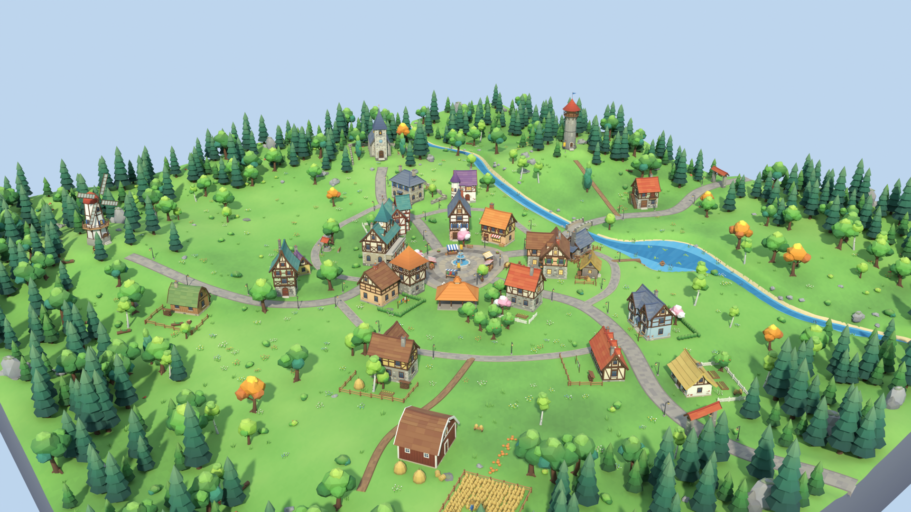
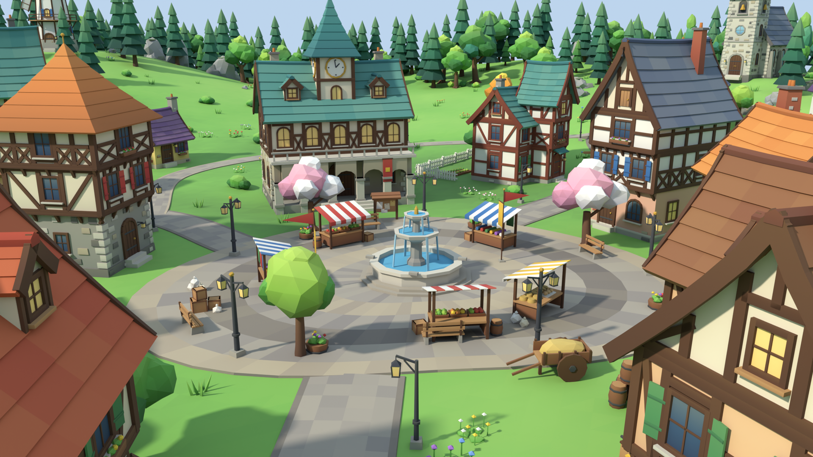
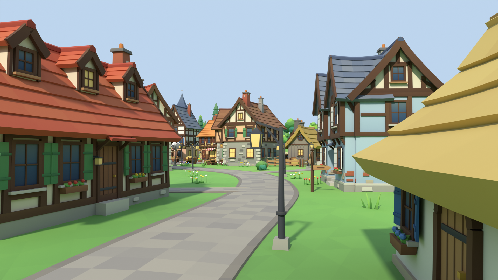
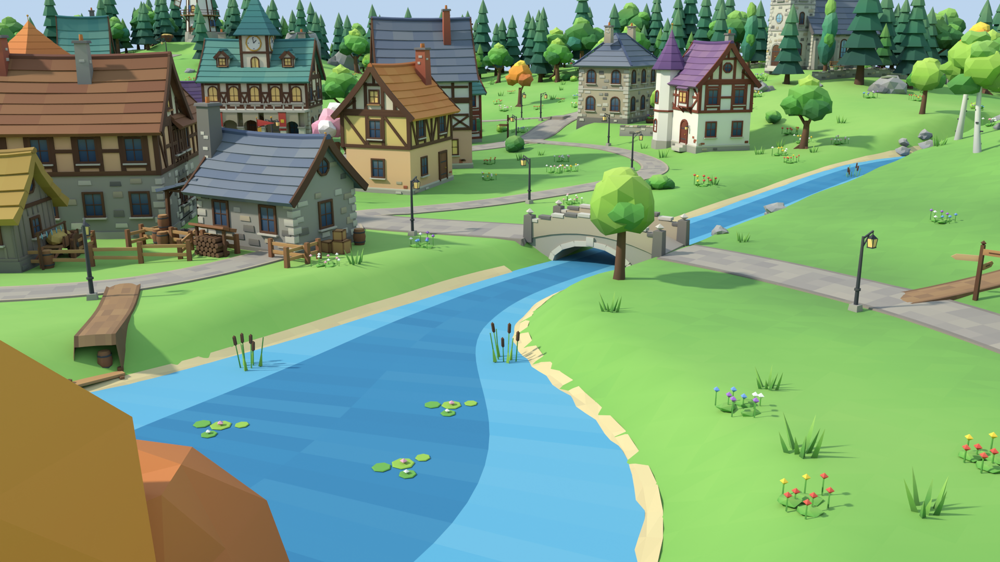
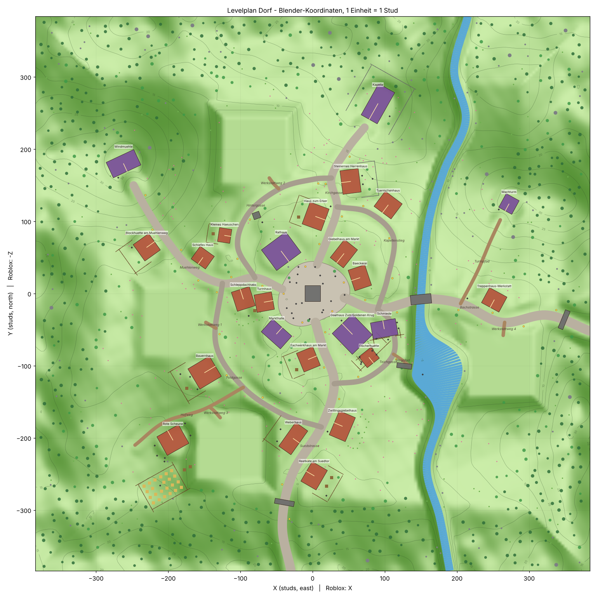

# Stylized Village – Roblox-Spielwelt aus Blender

Eine vollständige, zusammenhängende Dorf-Spielwelt für Roblox. Alle Modelle, das Gelände und der
Levelplan werden per Python mit der Blender-API (`bpy`) erzeugt – reproduzierbar, ohne Handarbeit
in einer GUI.



| | |
|---|---|
|  |  |
|  |  |

## Was enthalten ist

- **25 Gebäude**: 18 individuell modellierte Häuser und 7 Orientierungsbauten (Rathaus mit Uhrturm,
  Kapelle, Windmühle, Gasthaus, Schmiede, Wachturm, Markthalle)
- **33 Naturmodelle** (11 Baumarten, Büsche, Felsen, Blumen, Beete …) und **33 Dekorationen**
  (Brunnen, Laternen, Zäune, Marktstände, Brücke, Steg, Tor …)
- **15 Rohstoffmodelle** für die Sammelstellen (Kräuter, Pilze, Erze, Holz, Wasserpumpe …) und
  31 Maschinenmodelle für die Werkstatt
- **Gelände** 768 × 768 Studs mit drei Hügeln, Bachlauf und Teich, 36 Mesh-Kacheln
- **Straßennetz**: 4 Hauptstraßen, 4 Gassen, 3 Pfade, zentraler Marktplatz
- **Levelplan** `world/world_layout.json`: 1 889 Instanzen mit Position, Rotation, Skalierung –
  in Blender- **und** Roblox-Koordinaten
- **Roblox-Integration** `roblox/VillageWorldBuilder.lua`: setzt die importierten Meshes anhand des
  Plans zusammen, korrigiert Import-Maßstab und Pivot selbst, erzeugt Kollisions-Proxys und Lichter

Zahlen und Prüfergebnisse: [docs/validation_report.md](docs/validation_report.md),
Gebäudeliste: [world/level_summary.md](world/level_summary.md).

## Verzeichnisse

| Pfad | Inhalt |
|---|---|
| `blender/` | Python-Skripte. `village/` ist das Paket (Mesh-Baukasten, Gebäude, Natur, Deko, Gelände, Levelplan), darüber die Einstiegsskripte |
| `assets/houses`, `assets/landmarks`, `assets/nature`, `assets/props` | editierbare `.blend`-Quelldateien, eine pro Asset |
| `world/` | Levelplan (`world_layout.json`), Höhenkarte, Lageplan, komplett zusammengesetzte Szene `village_world.blend` |
| `exports/glb/` | ein `.glb` pro Asset bzw. Geländekachel |
| `exports/library/` | Sammeldateien `village_assets` und `village_terrain` als `.glb` und `.fbx` (für den Roblox-Import) |
| `exports/textures/` | die eine Palettentextur (1024 × 64 px), die alle Meshes verwenden |
| `previews/` | gerenderte Vorschauen (Welt aus 11 Perspektiven, Kontaktbögen aller Assets) |
| `roblox/` | Luau-Module: Builder, generierte Layout-Daten, optionale Voxel-Terrain-Variante |
| `tests/` | Mock der Roblox-API und Tests der Luau-Skripte |
| `docs/` | Dokumentation |

## Schnellstart

```bash
./scripts/setup_env.sh     # .venv mit bpy 5.3 (Python 3.13 nötig)
./build.sh                 # Assets + Welt bauen und prüfen (ca. 6 Minuten)
./build.sh --render        # zusätzlich alle Vorschauen rendern (ca. 15 Minuten, CPU)
```

Einzelschritte:

```bash
.venv/bin/python blender/build_assets.py          # Modelle, .blend, .glb, Sammeldateien, Manifest
.venv/bin/python blender/build_world.py           # Gelände, Levelplan, Weltszene, Luau-Daten
.venv/bin/python blender/render_previews.py world # Vorschauen
.venv/bin/python blender/audit_backfaces.py       # Rückseiten-Audit (ca. 5 Minuten)
.venv/bin/python blender/validate.py              # automatische Prüfungen
.venv/bin/python tests/test_roblox_builder.py     # Luau-Skripte gegen Roblox-Mock
```

## In Roblox verwenden

Kurzfassung – Details in [docs/ROBLOX_IMPORT.md](docs/ROBLOX_IMPORT.md):

1. `exports/library/village_assets.glb` und `village_terrain.glb` (ersatzweise die `.fbx`) mit dem
   3D-Importer nach `ServerStorage.VillageAssets` importieren.
2. Die vier Module aus `roblox/` als ModuleScripts nach `ServerStorage.VillageWorld` legen
   (oder per Rojo mit `default.project.json`).
3. `roblox/BuildVillage.commandbar.lua` in der Befehlsleiste ausführen.

## Stand und Grenzen

- **Tatsächlich geprüft**: Build läuft durch, 34 automatische Prüfungen bestehen (darunter ein
  Rückseiten-Audit aller 141 Meshes), alle Vorschauen wurden gerendert und gesichtet, die
  Platzierungslogik der Luau-Skripte wurde gegen einen Roblox-API-Mock ausgeführt.
- **Nicht geprüft**: der Import in Roblox Studio selbst – dafür gab es in der Entwicklungsumgebung
  keinen Zugang. Was dabei zu kontrollieren ist, steht in `docs/ROBLOX_IMPORT.md`.

Vollständiger Projektstand: [docs/PROJECT_STATUS.md](docs/PROJECT_STATUS.md).
