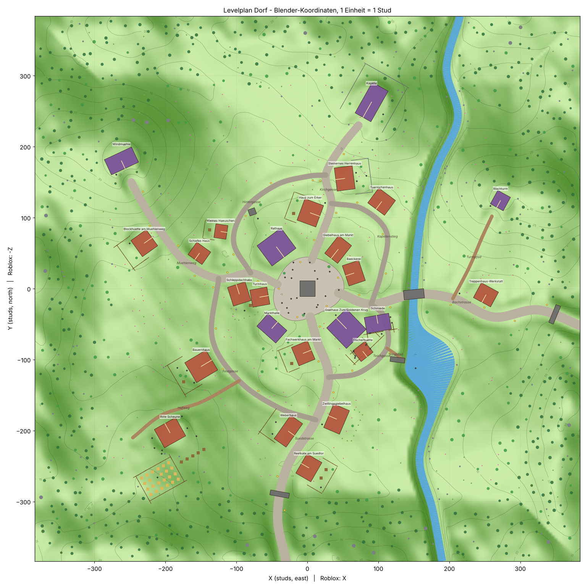

# Levelkonzept

Positionen aller Gebäude und Straßenlängen: [`world/level_summary.md`](../world/level_summary.md).
Maschinenlesbar: [`world/world_layout.json`](../world/world_layout.json).

## Leitidee

Ein gewachsenes Marktdorf in einer Talmulde. Vom Platz aus sieht man in jeder Richtung einen
anderen Orientierungspunkt; die Hauptstraßen führen jeweils auf einen davon zu. Niemand muss eine
Karte lesen, um sich zurechtzufinden.

| Richtung | Orientierungspunkt | Lage |
|---|---|---|
| Mitte | Rathaus mit Uhrturm, Marktbrunnen | am Platz |
| Norden | Kapelle mit Schieferspitze | auf dem Kirchhügel (+25 Studs) |
| Nordwesten | Windmühle | auf dem Mühlenberg (+36 Studs), höchster Punkt |
| Osten | Wachturm | auf dem Rücken jenseits des Bachs (+30 Studs) |
| Südosten | Teich mit Steg | tiefster Punkt, hinter dem Gasthaus |
| Südwesten | rote Scheune mit Weizenfeld | am Hofweg |

## Straßen

Vier Hauptstraßen treffen sich am unregelmäßig geformten Marktplatz; keine verläuft gerade.
Vier Gassen verbinden sie zu Schleifen, sodass es immer einen zweiten Weg gibt.

- **Südstraße** – Ortseingang mit Dorftor, längste Häuserzeile, S-Kurve zum Platz
- **Kirchgasse** – steigt nach Norden zur Kapelle
- **Mühlenweg** – nach Westen, dann bergauf zur Mühle
- **Bachstraße** – nach Osten über die Steinbrücke zum Osttor
- **Hintergasse** (NW), **Feldgasse** (SW), **Teichgasse** (SO), **Kapellenstieg** (NO) – die vier Schleifen
- **Turmpfad**, **Hofweg**, **Stegpfad** – unbefestigte Pfade zu Wachturm, Hof und Bootssteg

## Gelände

- Der Dorfkern liegt fast eben (±1 Stud), damit der Platz funktioniert.
- Drei Hügel und der ansteigende Kartenrand geben jeder Blickrichtung eine Silhouette und
  begrenzen die Welt natürlich – der Wald wird nach außen dichter.
- Der Bach kommt aus dem Tal zwischen Kirchhügel und Wachturmrücken, weitet sich zum Teich und
  verlässt die Karte im Süden. Sein Wasserspiegel fällt durchgehend.
- Unter jedem Gebäude ist das Gelände eingeebnet; Straßen sind leicht eingeschnitten.

## Bereiche

- **Marktplatz**: Brunnen, fünf Marktstände, Doppellaternen, Bänke, Blühbäume, Anschlagtafel
- **Am Platz**: Rathaus (N), Bäckerei und Giebelhaus (NO), Gasthaus (SO), Turmhaus und Markthalle (SW)
- **Südstraße**: Wohnhäuser mit umzäunten Gärten, Beeten, Wäscheleinen
- **Kirchhügel**: Kapelle mit ummauertem Kirchhof und Pappeln, Herrenhaus mit Steinmauer
- **Hof**: Scheune, Bauernhaus, Weizenfeld mit Zaun und Vogelscheuche, Kürbisse, Heuhaufen
- **Bach**: Schmiede nahe der Brücke, Fischerhütte, Steg mit Ruderboot, Schilf und Seerosen
- **Rand**: Mischwald, auf den Höhen Nadelwald, Felsgruppen, Lichtungen

## Gestaltungsregeln der Gebäude

- Massive Erdgeschosse (Stein, Putz), darüber auskragendes Fachwerk mit Knaggen
- Steile Dächer mit durchhängendem First, Schindelreihen und ausgestelltem Traufbereich
- Jedes Haus hat eine eigene Kombination aus Grundriss, Dachform und Farbe:
  Satteldach trauf- oder giebelständig, Walmdach, Zeltdach, Mansarddach, Schleppdach, Reetdach,
  Zwerchgiebel, Eckturm, Erker, Außentreppe, Veranda, Ladenfenster mit Markise
- Farben: warme Putztöne und acht Dachdeckungen (Ziegel in Rot, Orange und Braun, Schiefer,
  Petrol, Violett, Grün, Reet); das Petrol des Rathauses taucht nur an zwei weiteren Häusern auf

## Spielrelevante Daten im Layout

`world_layout.json` enthält neben den Instanzen:

- `roads`: Mittellinien aller Straßen in Roblox-Koordinaten (für NPC-Wege, Wegweiser)
- `water`: Bachverlauf mit Wasserspiegel und halber Breite
- `spawn`: Startpunkt auf dem Marktplatz
- `lighting`: vorgeschlagene Lichtstimmung
- je Asset: Bounding-Box, Kollisions-Proxys, Lichtanker

Die Gebäude sind Außenhüllen ohne Innenräume.
