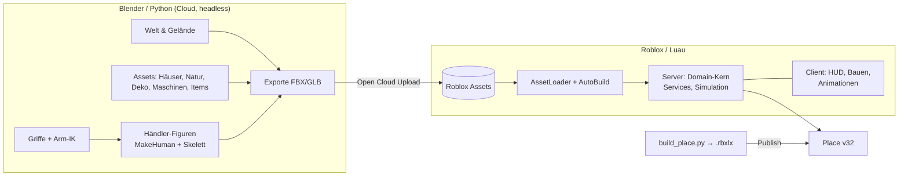

# Arcane Village – Übersicht

> [!abstract] In einem Satz
> Ein Roblox-Spiel, in dem man in einem stilisierten Fachwerkdorf Zutaten sammelt, in einer eigenen,
> begehbaren Werkstatt Tränke braut, die Produktion mit Förderbändern automatisiert und an
> Händler und Kunden verkauft. Welt, Figuren und Modelle sind **vollständig per Python/Blender
> erzeugt**, das Gameplay ist in Luau geschrieben.

> [!info] So liest du diesen Vault
> Öffne **den Repository-Ordner `Roblox-Game` als Vault** (nicht nur `obsidian/`). Dann
> funktionieren auch die Links auf `docs/…` und die eingebetteten Bilder aus `previews/…`.
> Jede Notiz hat Tags im Kopf; die Graph-Ansicht zeigt, wie alles zusammenhängt.

![[previews/world/01_overview_southwest.png]]

## Karte des Wissens

### Projekt
- [[Ziel, Umfang und Stand]] – was das Spiel ist, was fertig ist, was nicht
- [[Arbeitsregeln und Konventionen]] – Maßstab, Koordinaten, Sprache, „alles generiert“
- [[Befehle – Spickzettel]]
- [[Glossar]]

### Welt (Blender)
- [[Blender-Pipeline]] – wie aus Code Modelle werden
- [[Dorf und Levelplan]] – Straßen, Orte, Gebäude
- [[Gelände, Kollision und Boden]]
- [[Assets und Modellbibliotheken]]

### Gameplay (Luau)
- [[Gameplay-Architektur]] – Client/Server, Schichten, Anfrageablauf
- [[Kernloop und Wirtschaft]] – Sammeln, Brauen, Verkaufen, Ruf, Aufträge
- [[Werkstatt, Bauen und Logistik]] – Raster, Maschinen, Bänder, Rohre, Hologramm
- [[Ware auf Förderbändern]] – wie Items flüssig über Bänder gleiten
- [[Designentscheidungen D1–D17]]

### Händler und Figuren
- [[Die fünf Händler]]
- [[Charakter-Pipeline (MakeHuman)]]
- [[Griffsystem]] – wie Hände Dinge halten
- [[Arm-IK und Bewegungsschleifen]]
- [[Griffvalidierung und Ergebnisse]]

### Roblox
- [[Veröffentlichen und Open Cloud]]
- [[Händler-Animation in Roblox]]

### Qualität
- [[Tests und Prüfungen]]
- [[Offene Punkte und Risiken]]
- [[Fehlerchronik – gelernte Lektionen]]

## Wichtigste Zahlen

| Was | Wert |
|---|---|
| Welt | 768 × 768 Studs, 25 Gebäude, 1 879–1 889 platzierte Objekte |
| Assets | 91 Dorf-Assets, 31 Maschinen, 45 Items, 15 Rohstoffmodelle, 5 Händler |
| Gameplay-Daten | 45 Items, 30 Rezepte (+5 Versorgung), 18 Maschinen, 13 Logistikteile, 28 Forschungsknoten, 20 Hauptquests |
| Händler | 9 skinned Meshes, 26 Knochen je Figur, 88 000–100 000 Dreiecke |
| Veröffentlicht | Place-Version **32** (2026-11-18) |

> [!warning] Ehrlicher Stand
> Vieles ist **auf dem Roblox-Server gemessen** (per Open Cloud), aber **nichts wurde in Roblox
> Studio oder auf einem echten Gerät angesehen**. Aussehen, Touch-Bedienung und Leistung sind
> offen → [[Offene Punkte und Risiken]].
