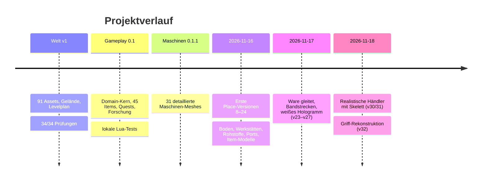

# Ziel, Umfang und Stand

Zurück: [[Arcane Village – Übersicht]]

## Ziel
- Eine **zusammenhängende Dorf-Spielwelt für Roblox**, erzeugt ausschließlich per Python und der
  Blender-API (`bpy`), reproduzierbar ohne Handarbeit in einer GUI.
- Darauf ein Spiel **„Arcane Village“**: Trankbrauerei mit Automatisierung, Dorfwirtschaft,
  Forschung, Co-op für bis zu 4 Spieler.
- Verbindlicher Vertrag: `docs/ARCANE_VILLAGE_CLAUDE_MASTER_SPEC.md` (20 Kapitel). Abweichungen
  stehen in [[Designentscheidungen D1–D17]].
- Rahmenbedingung von Anfang an: **kein Roblox Studio**. Alles läuft in einer Linux-Cloud.
  Später kam Zugriff über die **Roblox Open Cloud API** hinzu (Upload, Veröffentlichen,
  Server-Skripte ausführen) → [[Veröffentlichen und Open Cloud]].

## Zeitleiste

## Was fertig ist (Kurzfassung)

| Bereich | Stand |
|---|---|
| Welt, Gelände, Straßen, 25 Gebäude | fertig, im Place geladen und vermessen |
| Gameplay-Kern (Daten + Logik) | fertig, lokal getestet (Lua 5.5 / lupa) |
| Werkstätten auf 4 Grundstücken | im Place gebaut und vermessen |
| Bauen mit Hologramm, Bandstrecken | im Place gemessen, Bedienung am Gerät ungeprüft |
| Ware auf Bändern (Client-Animation) | lokal gemessen, Attribute im Place geprüft |
| 5 realistische Händler mit Skelett und Animation | Place v32, Posen auf 0,0005 Studs geprüft |
| Griffe, Armhaltungen, Werkzeuggebrauch | gelöst, gemessen, gerendert, bewertet |

## Was ausdrücklich fehlt
Siehe [[Offene Punkte und Risiken]]. Die großen Lücken:
- Sichtprüfung in Studio / auf dem Handy (alles Visuelle in Roblox)
- Markt-Innenraum, sichtbare Kunden-NPCs, Weltkarte, Blueprint-UI, Co-op-UI
- Sound, Partikel, englische Texte, Leistungsmessung
- Monetarisierung (bewusst nicht enthalten)

## Statusbegriffe (überall im Projekt)

| Begriff | Bedeutung |
|---|---|
| `TESTED_LOCAL` | in der Cloud mit Lua 5.5 (lupa) + Python geprüft |
| gemessen im Place | per Open Cloud im echten veröffentlichten Place ausgeführt |
| `UNVERIFIED_IN_STUDIO` / `UNVERIFIED_STUDIO` | Code existiert, nie in Studio/auf Gerät gesehen |
| `PASS_AUTOMATED` / `PASS_VISUAL` / `FAIL` | Status im Griffbericht → [[Griffvalidierung und Ergebnisse]] |
