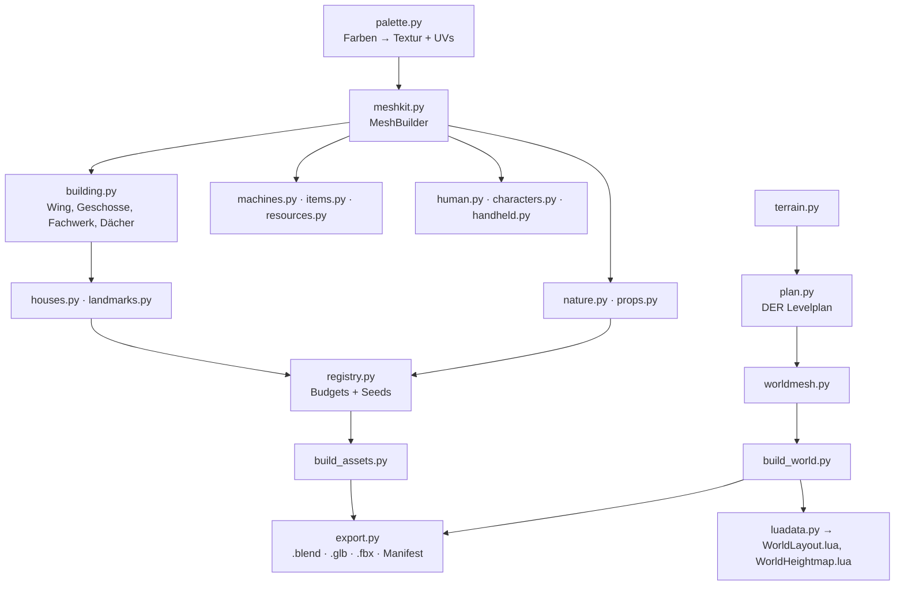

# Blender-Pipeline

Zurück: [[Arcane Village – Übersicht]] · Siehe auch: [[Assets und Modellbibliotheken]], [[Dorf und Levelplan]]

## Umgebung
- Blender **als Python-Modul** `bpy==5.3.0` (Python 3.13). Kein installiertes Blender, keine GPU.
- Rendern mit **Cycles auf der CPU** (EEVEE geht im Container nicht).
- Weitere Pakete: `numpy` (Gelände), `matplotlib` (Lageplan), `lupa` (Lua für Tests).

## Prinzip
> [!quote] Alles ist Code
> Jedes Modell ist eine Python-Funktion mit festem Seed. Dieselbe Eingabe ergibt dieselbe Datei –
> Änderungen sind per Diff nachvollziehbar. Nachteil: Änderungen brauchen Python statt Maus.



## Module in `blender/village/`

| Modul | Aufgabe |
|---|---|
| `palette.py` | Farbliste, schreibt `village_palette.png`, liefert UV je Farbe |
| `meshkit.py` | `MeshBuilder`: Primitive, Transformstapel, Kollisions-Proxys, Lichtanker |
| `building.py` | Architektur-Baukasten (`Wing`): Fundament, Geschosse, Fachwerk, Fenster, Türen, Dächer, Gauben |
| `houses.py`, `landmarks.py`, `nature.py`, `props.py` | Rezepte der Dorf-Assets |
| `registry.py` | alle Assets mit Dreiecksbudget und Seed |
| `terrain.py` | Höhenmodell, Kurven, Distanzfelder (nur numpy) |
| `plan.py` | Levelplan: `ROADS`, `STREAM_PTS`, `ALONG`, `SITES`, `WORKSHOP_PLOTS` |
| `worldmesh.py` | Geländekacheln, Straßenbänder, Platz, Wasser, Ufer |
| `planmap.py` | zeichnet `world/level_plan.png` |
| `coords.py`, `export.py`, `luadata.py`, `scene.py` | Koordinaten, Export, Luau-Serialisierung, Render-Setup |
| `machines.py`, `items.py`, `resources.py`, `workshop.py`, `market.py` | Gameplay-Modelle |
| `human.py`, `characters.py`, `wardrobe.py`, `outfits.py`, `heads.py`, `looks.py` | Händler → [[Charakter-Pipeline (MakeHuman)]] |
| `handheld.py`, `grips.py`, `gripcheck.py`, `armik.py` | Werkzeuge, Griffe, IK → [[Griffsystem]] |

## Ein Hausrezept (Beispiel)

```python
def house_19_example(mb):
    wg = Wing(mb, 22, 16, found=1.4)
    wg.storey(10, style="stone", openings={
        "front": [door(0.3, arch=True, lantern=1), win(0.75, shutters="cloth_green")]})
    wg.storey(9, style="timber", color="plaster_cream", jetty=1.0,
              openings={"front": wins(2, z=2.8)})
    wg.gable("roof_red", ridge="x", pitch=52, gable_win="round")
    wg.chimney(-5, 2.5)
    finish(mb, wg.z + wg.roof_h)
```

## Typische Änderungen

| Wunsch | Wo | Danach |
|---|---|---|
| Neues Haus | `houses.py` + `HOUSES`; Standort in `plan.py` | `build_assets.py`, `build_world.py`, `validate.py` |
| Haus verschieben | `plan.py` (`ALONG` / `SITES`) | `build_world.py` |
| Straße ändern | `plan.py` (`ROADS`) | `build_world.py` |
| Weniger Bäume | `plan.py` → `scatter_nature` | `build_world.py` |
| Neue Farbe | an `palette.COLORS` anhängen | alles neu bauen |
| Hügel | `terrain.py` → `HILLS` | `build_world.py` |

## Technische Entscheidungen (Welt)

| Entscheidung | Grund | Nachteil |
|---|---|---|
| Eine Palettentextur, ein Material | passt zu MeshPart, günstig auf Handys | keine Detailtexturen |
| Gelände als Mesh-Kacheln (4-Stud-Raster) | sieht aus wie die Vorschau | braucht präzise Kollision → [[Gelände, Kollision und Boden]] |
| Builder misst Import-Maßstab und Pivot selbst | Import war nicht testbar | nur bei aufrechten Meshes |
| Kollision über Proxy-Körper | stabil, billig | grob |
| ≤ 10 000 Dreiecke je Dorf-Mesh | konservativ | Rathaus/Gasthaus weniger Details |
