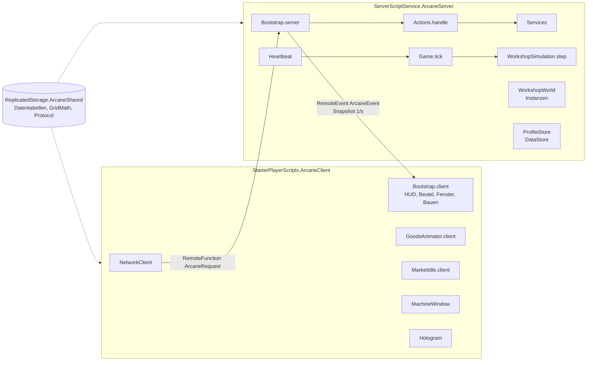

# Gameplay-Architektur

Zurück: [[Arcane Village – Übersicht]] · Doku: `docs/GAMEPLAY_ARCHITECTURE.md` · Code: `roblox/gameplay/`

## Schichten

| Schicht | Dateien | Roblox-API? | Getestet |
|---|---|---|---|
| Daten | `shared/Config, Items, Recipes, Machines, Research, Quests, Locations, MarketCatalog …` | nein | `test_data.py` |
| Domain | `server/*Service.lua`, `Actions`, `Game`, `WorkshopSimulation`, `CoOpPermissions`, `VillageAdapter`, `ProfileStore` | nein | `spec_*.lua` |
| Adapter | `Bootstrap.server.lua`, `WorkshopWorld.lua`, `MarketWorld.lua`, `ResourceWorld.lua` | ja | Syntax + Messung im Place |
| Client | `client/*.lua` | ja | nur Syntax |

> [!info] Warum so? (D2)
> Die Domain-Logik ist reines Lua 5.1 ohne Roblox-API. Ein Test-Harness (`roblox/gameplay/tests/harness.py`)
> stellt minimale `script`/`game`-Objekte bereit – **es laufen dieselben Dateien wie in Roblox**,
> nur ohne Studio.

## Genau ein Schreiber je Datenart

| Daten | Modul |
|---|---|
| Münzen, Wissen, Ruf | `EconomyService` |
| Item-Bestände | `InventoryService` (Regeln) |
| Werkstatt-Layout, Blueprints | `PlacementService` |
| Jobs, Rezepte | `ProductionService` |
| Transport fest/flüssig | `LogisticsService` |
| Regalverkäufe | `ShopService` |
| Quests, Aufträge, Stränge | `QuestService` |
| Forschung | `ResearchService` |
| Sammelknoten | `ResourceService` |
| Profil | `ProfileService` (Form), `ProfileStore` (DataStore) |
| Co-op-Rechte | `CoOpPermissions` |

## Ablauf einer Anfrage – `Actions.handle(world, session, action, payload, ctx)`
1. `SecurityService.validate` – nur deklarierte Felder mit geprüftem Typ (`Protocol.actions`).
2. Rate-Limit je Spieler und Aktion (Token-Bucket).
3. Wiederholungsschutz über `actionId` (letzte 64).
4. Safe-Mode-Sperre, wenn das Profil nicht geladen werden konnte.
5. Handler: Rechte, Nähe (Position vom Server), Freischaltung, Kosten.
6. Ergebnis `{ ok, code, version, payload }` + aktueller Snapshot.

> [!important] Der Client schickt nie Positionen, Preise, Geldmengen oder Objektpfade.

> [!bug] Gelernter Fehler: Roblox-Nutzer-IDs
> `SecurityService` prüfte Nutzernummern als `"int"` bis 1 000 000 – echte IDs sind Milliarden.
> Folge: niemand galt als „in der Werkstatt“. Fix: eigener Feldtyp `"user"` + Regressionstest
> mit realistischen IDs. → [[Fehlerchronik – gelernte Lektionen]]

## Simulation – `WorkshopSimulation.step` (alle 0,25 s)
Graph bei Layoutänderung neu bauen → feste Güter bewegen → Flüssigkeiten → Jobs starten,
fortschreiben, abschließen → Kunden → Kennzahlen. `dt` ≤ 1 s, je Maschine ≤ 4 Zyklen je Schritt.
**Kein Offline-Fortschritt:** Jobs frieren beim Speichern ein.

## Persistenz
- `ProfileStore` mit Sitzungs-Lock, Revisionsprüfung, Wiederholungen.
- Gemessen im Place: `[Arcane] server ready - persistent saves: true`.

## Co-op (Phase 8)
- Rollen `visitor < operator < builder < owner`, serverseitig geprüft.
- Einladen/Entziehen; verlässt der Host, werden Gäste ausgeworfen; Blueprints atomar platzieren.
- **Offen:** keine Bedienoberfläche für Einladungen und Blueprints.
