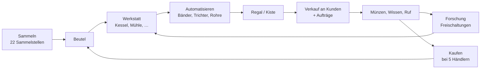

# Kernloop und Wirtschaft

Zurück: [[Arcane Village – Übersicht]] · Verwandt: [[Werkstatt, Bauen und Logistik]], [[Die fünf Händler]]

## Datenbasis v1
| Was | Anzahl |
|---|---:|
| Items | 45 |
| Herstellrezepte (+ Versorgung) | 30 (+5) |
| Maschinen | 18 |
| Lager-/Logistikteile | 13 |
| Forschungsknoten (DAG) | 28 |
| Hauptquests | 20 (q01–q20) |
| Auftragsvorlagen | 20 |
| NPC-Stränge | 8 (24 Schritte) |
| Dorfprojekte | 3 |
| Orte | 16 |
| Sammelknoten | 22 |

## Systeme
- **Sammeln:** Knoten mit Bestand und Nachwachsen; leerer Vorrat wird durchscheinend.
- **Handbrauen**, Beutel, Regal; **Kunden kaufen aus echtem Bestand**.
- **Auftragstafel:** 3 Angebote, Tageslimit für Ruf.
- **Ruf 0–5:** wirkt auf Preise und Kundenfrequenz (schaltet noch keine Dorfdienste frei → PARTIAL).
- **Forschung:** DAG mit Vorbedingungen; z. B. mehr als zwei Kisten erst nach „Lagerhaltung“
  (10 Wissen, D12).
- **Kräuterbeet:** gibt das Saatgut im Ausgang zurück – keine Gratisproduktion (D9).
- **Holzkohle** ist Sammelrohstoff (Meiler an der Schmiede), nicht kaufbar (D7) – heute verkauft
  Aron trotzdem Holzkohle-Bündel als Abkürzung.
- **Dorfprojekt:** sitzungsweit, jede Spende einmal gezählt; verändert die Welt noch nicht sichtbar.

## Belege
- Ein **Bot** (`roblox/gameplay/tests/bot.lua`) löst q01 → q20, alle 24 Strangschritte und stellt jedes Rezept
  mindestens einmal her – nur über Client-Aktionen (`spec_progression`).
- Bot-Zeit bis q20: 54 min = Untergrenze bei perfektem Spiel; echte Spielzeit deutlich länger.

## Händlerangebote
Siehe Tabelle in [[Die fünf Händler]]. Wasser ist gratis (Brunnen, Steg, Brücke); Phiolen sind
das einzige kaufbare Zwischenprodukt; 14 verkaufbare Produkte.

> [!todo] Offen
> - [ ] Sichtbare Kunden-NPCs (Kauf läuft logisch)
> - [ ] Weltkarte, Rezept-Codex, ausführliche Kennzahlen
> - [ ] Texte auf Englisch
> - [ ] Monetarisierung (bewusst nicht enthalten)
