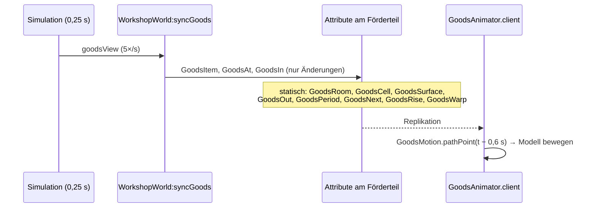

# Ware auf Förderbändern

Zurück: [[Arcane Village – Übersicht]] · Verwandt: [[Werkstatt, Bauen und Logistik]], [[Designentscheidungen D1–D17]] (D16, D17)

> [!abstract] Idee (D16)
> Der Server schickt **keine Positionen**. Er veröffentlicht je Förderteil nur *welche Ware*,
> *wann angekommen*, *aus welcher Richtung*. Der Client zeichnet **0,6 s verzögert** – jede
> Übergabe ist bekannt, bevor sie gezeichnet wird, also gleitet die Ware ohne Halt und ohne
> Vorhersagefehler. Nachteil: Das Bild liegt 0,6 s hinter dem Spielstand.

## Effekte
- **In Maschinen/Kisten:** rutscht hinein, kleiner Hüpfer, sinkt, schrumpft, dreht sich (0,4 s).
- **Aus Maschinen/Trichtern:** steigt aus der Öffnung und wächst.
- **Aufzug:** ein durchgehendes Objekt fährt eine Etage hoch (12 Studs).
- **Magisches Tor:** schrumpft wirbelnd im Portal (bis 2 %), erscheint am Partnertor.
- **Kurven:** Ware und Querstege fahren einen Viertelbogen.
- Richtung zeigen mitlaufende Querstege (4 je Band, nur im Umkreis von 70 Studs).

## Gemessen
- Lokal (`spec_goods`, echte Simulation, Updates 0,2 s mit 80–200 ms Verzögerung, 60 fps):
  größter Schritt 0,022 Studs je Bild (Soll 0,0167), 0 von 8 396 Punkten stehend, nie mehr
  Modelle als Ware; Aufzug und Tor je 12/12 Waren als dasselbe Objekt.
- Im Place: Auflagehöhe = Bandoberfläche (3,21), Laufbahn `BELT_TOP` 0,69 Studs, Ware liegt ohne
  Abstand auf; 45 Item-Modelle in `ReplicatedStorage.ArcaneItemModels`.
