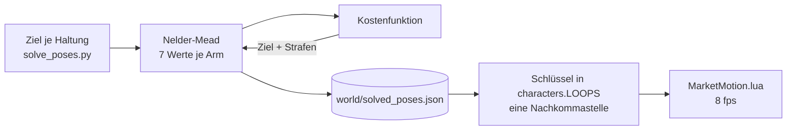

# Arm-IK und Bewegungsschleifen

Zurück: [[Die fünf Händler]] · Code: `blender/village/armik.py`, `blender/solve_poses.py`,
`characters.LOOPS` · Ergebnis: `world/solved_poses.json`

## Grundidee
Armwinkel werden **nicht geschätzt**, sondern aus Zielen gelöst („Flasche aufrecht vor die
Brust“, „Hammerfläche auf das Erz“) und als Schlüssel in die Schleife geschrieben.

## Variablen und Kosten
- **7 Variablen:** Oberarm (rx, ry, rz), Unterarm (rx, rz), Hand (rx, rz).
- **Strafen:**
  - Gelenkgrenzen: Ellbogen 10–140°, Oberarm ≤ 95° gehoben, Ellbogen nicht weit hinter der Schulter.
  - Handgelenk: ≤ 45° gebeugt, ≤ 20° seitlich, **≤ 20° in sich verdreht**, Unterarmdrehung ≤ 80°.
  - Körperkollision gegen den Rumpf (BVH, Arme ausgenommen); Gegenstand und Hand außerhalb.
  - Bequemlichkeit: Ellbogen nahe 90°, Arm tief, Handgelenk gerade.
- `prior` hält eine Lösung nahe an einer Nachbarpose (für Bewegungspfade).
- `fixed` hält den anderen Arm fest (z. B. Erz-Hand beim Hammerschlag).

> [!important] Erkenntnis: Euler-Kanäle sind keine Unterarmdrehung
> Ein Schlüssel `fore rz + 20°` dreht bei gebeugtem Ellbogen **nicht** um die Unterarmachse,
> sondern schwenkt den Unterarm seitlich. Lios Flasche wanderte so 0,27 Studs vor das Gesicht.
> Lösung: „Gegenstand in der Hand drehen“ wird als eigene Pose gelöst (`turned()`): gleiche
> Position, Ziel-Unterarmdrehung ±18–20°.

> [!important] Erkenntnis: Der Kanal `hand rz` ist reine Verdrehung im Handgelenk
> Gemessen: `hand rz = 40°` → 39° Verdrehung, nur 5° Beugung. Die alten Schleifen verdrehten
> das Handgelenk bis **115°** (Lio) bzw. 76° + 127° Unterarm (Aron). Echte Unterarmdrehung
> passiert im Unterarm (≈ ±85°). Seitdem misst `gripcheck.arm_twist` per **Swing-Twist-Zerlegung**.

## Die Haltungen

| Händler | Ziel | Ergebnis |
|---|---|---|
| Esme | Stiel auf der rechten Schulter (Akromion), Hand vor derselben Schulter, Stiel vorne→hinten | Stiel 0,09 Studs über der Schulter, Ellbogen 140° |
| Nyra | Kristallmitte vor der Brust, Spitze schräg nach oben/vorn/außen | Ellbogen 124°, Arm kaum gehoben |
| Lio „halten“ | Flasche aufrecht vor dem unteren Brustkorb | Ellbogen 118° |
| Lio „reiben“ | Tuch-Hand oben/unten an der Flasche | zwei Posen im Wechsel |
| Lio „Licht“ | Flasche auf Augenhöhe, fast Armlänge vor der rechten Schulter, Gesicht frei | Ellbogen 95°, Arm 65° gehoben |
| Aron Erz | Erz vor dem Bauch, **Position aus 5 Kandidaten gewählt** | bester Kandidat (0,1 / 0,5 / 0,25) |
| Aron Schlag | Pfad: Treffer + Abstände 0,04/0,09/0,15/0,25/0,35 entlang der Schlaglinie | Fläche trifft auf 0,004 Studs |

## Arons Hammerschlag im Detail
| Zeit (s) | Rechter Arm (Hammer) | Linker Arm (Erz) |
|---|---|---|
| 0 – 1,125 | Ruhe → Ausholen (gap35) | hält das Erz vor dem Bauch |
| 1,125 – 1,625 | Pfad gap25 → gap15 → gap09 → gap04 | |
| **1,75** | **Treffer 1** (Fläche 0,0043 Studs vom Erz) | |
| 1,875 – 2,5 | zurück bis gap25, wieder hin | |
| **2,625** | **Treffer 2** | |
| 2,75 – 3,125 | zurück bis gap35 | |
| 3,125 – 6 | Ruhe | hebt das Erz bei 4,25 – 5 s leicht an |
- Eine gelöste Pose **je Animationsbild** (1/8 s), damit der Kopf nie durch das Erz fährt.
- Höchste Ausholpose (gap45) gestrichen: der Hammer berührte im Build-Check die Haut.

> [!bug] Fehler im Solver: Flächennormale zeigte in den Kopf
> `normal = Fläche − Punkt davor` zeigte **in** den Hammerkopf. „Fläche zeigt zum Erz“ drehte
> deshalb die Rückseite zum Erz, die Rückzugslinie lief tangential → der Kopf streifte seitlich
> 0–8 mm am Erz entlang. Nach dem Vorzeichenfix: zwei saubere Treffer, kein Streifen.

## Zwei-Hand-Test (Kiste, nur Testszene)
`blender/grip_test_crate.py`: Griffe zuerst in der Hand gelöst, rechter Arm in Trageposition,
linker Arm per IK an den zweiten Griff (Position + Achse + Handfläche zur Kiste).
Ergebnis: linke Hand 0,001 Studs vom Griff; linker kleiner Finger nur 1 Glied am Griff; linker
Ellbogen steht ab.

![[previews/grips/after/crate_two_hands.png]]
