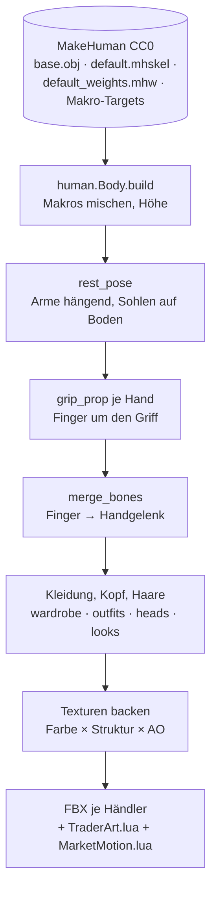

# Charakter-Pipeline (MakeHuman)

Zurück: [[Die fünf Händler]] · Code: `blender/village/human.py`, `characters.py`, `build_characters.py`

## Körper
- Daten: `assets/thirdparty/makehuman` (CC0, `LICENSE.md` dort). Eigener Lader, **kein**
  MakeHuman-Programm.
- Figurenraum: Z oben, Gesicht nach −Y, links = +X; 1 Stud = 0,27 m.
- Ruhepose: Arme hängend, Ellbogen leicht gebeugt, Schultern entspannt; Füße stehen mit der
  Hautsohle auf dem Boden.

## Skelett und Skinning
- Oberster Knochen `Root` (ohne Gewichte), MakeHuman-Wurzel heißt `hips`.
- Linear Blend Skinning, **höchstens 4 Knochen je Vertex**.
- Fingerknochen existieren nur beim Bauen: Der Griff wird gelöst und eingebacken, danach werden
  die Fingerknochen mit dem Handgelenk verschmolzen → in Roblox **26 Knochen**, keine Finger.
- Animiert werden **10 Knochen**: `spine03`, `spine01`, `neck01`, `head`, `upperarm01.L/R`,
  `lowerarm01.L/R`, `wrist.L/R`.

## Aussehen
- **Kleidung:** anliegende Teile = Körperoberfläche nach außen versetzt (Falten an Ellbogen, Knien,
  Taille); Röcke, Schürzen, Umhang folgen Körperquerschnitten; Stiefel über einem Leisten.
  Verdeckte Haut wird entfernt.
- **Kopf:** Augäpfel mit Iris/Pupille, Wimpern, Brauen aus einzelnen Härchen; Haare aus Haarkappe +
  hunderten Strähnen; Hüte, Kapuze, Brille, Bart.
- **Texturen:** je Mesh gebacken: Farbe × prozedurale Struktur (Gewebe, Leder, Filz, Poren) ×
  Ambient Occlusion. AO wird in einer **Arme-ab-Pose** gebacken, damit Arme keine Schatten
  einbrennen.

## Grenzen und Ausgaben
- ≤ **19 500 Dreiecke je Mesh** (Roblox-Grenze 20 000), 9 Meshes je Figur, 88 000–100 000 gesamt.
- Ausgaben:
  - `exports/library/trader_<rolle>.fbx` (je ein Roblox-Asset)
  - `exports/textures/traders/*.png`
  - `roblox/gameplay/server/TraderArt.lua` (Meshes, Höhe, Referenzposen)
  - `roblox/gameplay/shared/MarketMotion.lua` (lokale Knochenrotationen, 8 fps)
  - `previews/market/01-haendler.png`, `02-bewegung.png`, `03-haende.png`
- Build-Prüfungen: jeder Finger am Werkzeug, Dreiecksgrenze, 4 Gewichte, Schleifen ohne Sprung,
  Werkzeug nie in der (geschlossenen) Haut. Dauer ~25 min.

![[previews/market/03-haende.png]]
