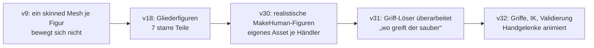

# Die fünf Händler

Zurück: [[Arcane Village – Übersicht]] · Doku: `docs/MARKET_MERCHANTS.md`

![[previews/market/01-haendler.png]]

| Händler | Figur | Hält (rechts / links) | Schleife | Sortiment |
|---|---|---|---|---|
| **Selma Wurzelbund** | Kräuterhexe, ≈ 40 J., Spitzhut, Zöpfe, Schürze | Kräuterbund / Korb | riecht an den Kräutern, legt sie Richtung Korb (8 s) | Minze, Sonnenblatt, Rote Beeren, Saatgut |
| **Nyra Dämmerhut** | Nachtsammlerin, ≈ 60 J., schlank, Kapuze, Umhang | Kristall / Laterne | hält den Kristall vor die Brust und dreht ihn (7 s) | Dämmerpilz, Mondblatt, Rohkristall |
| **Lio Glasfunke** | Glasbläser, ≈ 22 J., Locken, Schutzbrille | Flasche / Tuch | poliert die Flasche, hält sie seitlich gegen das Licht (6,5 s) | Sand, leere Phiolen |
| **Aron Glutbart** | Schmied/Erzhändler, ≈ 43 J., kräftig, Vollbart, Schürze | Hammer / Erz | hält das Erz, trifft es zweimal mit der Hammerfläche (6 s) | Holzkohle, Kupfer-, Eisenerz |
| **Esme Eichenmaß** | Holz-/Steinlieferantin, ≈ 33 J., sportlich, Federhut | Axt / Zollstock | Axt auf der Schulter, peilt am Zollstock (8 s) | Holzscheite, Stein |

## Körperformen (MakeHuman-Makros, `characters.SHAPE`)

| | gender | age | muscle | weight | Herkunft | Höhe (Studs) |
|---|---:|---:|---:|---:|---|---:|
| selma | 0,0 | 0,62 | 0,5 | 0,62 | kaukasisch | 6,15 |
| nyra | 0,0 | 0,8 | 0,35 | 0,42 | kaukasisch 0,7 / asiatisch 0,3 | 6,3 |
| lio | 1,0 | 0,52 | 0,52 | 0,44 | afrikanisch 0,6 / kaukasisch 0,4 | 6,45 |
| aron | 1,0 | 0,64 | 0,88 | 0,68 | kaukasisch | 6,7 |
| esme | 0,0 | 0,56 | 0,68 | 0,5 | kaukasisch 0,6 / afrikanisch 0,1 / asiatisch 0,3 | 6,3 |

## Waren und Freischaltungen

| Händler | Bündel | Münzen | Freischaltung |
|---|---|---:|---|
| Selma | 2 × Minze | 26 | Start |
| Selma | 2 × Sonnenblatt | 32 | Start |
| Selma | 2 × Rote Beere | 48 | Handwerk |
| Selma | 1 × Minzsaat | 24 | Kräuteranbau |
| Selma | 1 × Sonnenblattsaat | 29 | Kräuteranbau |
| Nyra | 1 × Dämmerpilz | 32 | Start |
| Nyra | 1 × Rohkristall | 58 | Runenkunde |
| Nyra | 2 × Mondblatt | 44 | Mondbotanik |
| Lio | 4 × Sand | 20 | Handwerk |
| Lio | 4 × Phiole | 32 | Glashütte |
| Aron | 4 × Holzkohle | 24 | Handwerk |
| Aron | 2 × Kupfererz | 34 | nach q11 |
| Aron | 2 × Eisenerz | 42 | nach q11 |
| Esme | 2 × Holzscheit | 18 | Handwerk |
| Esme | 4 × Stein | 20 | Handwerk |

## Entwicklungsgeschichte der Figuren

- Ursache v9: Der Upload legte die Bones **aller** Figuren in ein gemeinsames `RootPart`.
- Lösung v30: **jeder Händler ein eigenes Asset** (`trader_<rolle>.fbx`) → [[Händler-Animation in Roblox]].

Weiter: [[Charakter-Pipeline (MakeHuman)]] · [[Griffsystem]] · [[Arm-IK und Bewegungsschleifen]]
