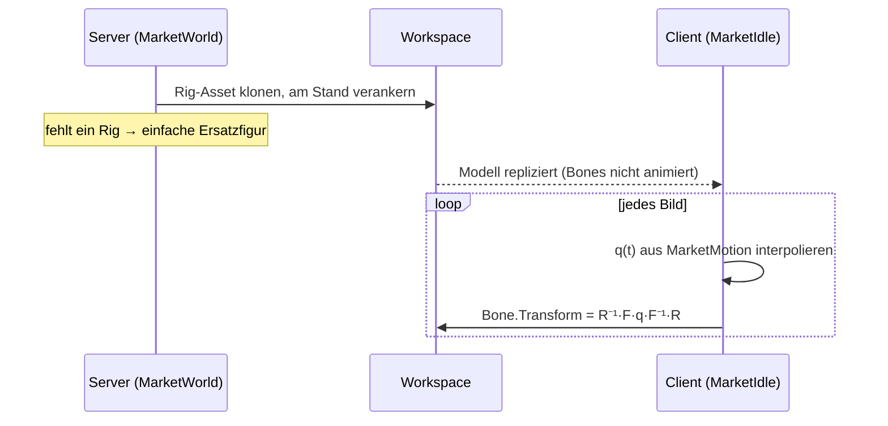

# Händler-Animation in Roblox

Zurück: [[Die fünf Händler]] · Code: `MarketWorld.lua`, `MarketIdle.client.lua`, `TraderArt.lua`, `MarketMotion.lua`

## Was Roblox aus dem FBX macht (gemessen)
- Ein Rig-Modell mit `RootPart` (enthält die Bones), skinned **MeshParts** und einem
  **`AnimationController`** – **kein `Humanoid`**.
- Die Knochen kommen mit **eigener Ruhe-Orientierung** an (nicht Identität).
- Bones werden **nicht repliziert** → die Animation muss auf jedem Client laufen.

## Die Formel
Der Client setzt pro Bild für jeden animierten Knochen:

$$
\text{Bone.Transform} = R^{-1} \cdot F \cdot q \cdot F^{-1} \cdot R
$$

- $R$ = Ruhe-Orientierung des Knochens in Roblox
- $F$ = Figurenrahmen (Blender-Konvention)
- $q$ = lokale Rotation aus `MarketMotion.lua` (8 Bilder/s, interpoliert)

> [!tip] Warum diese Formel?
> Sie hängt nicht davon ab, wie der Importer die Knochen ausrichtet. Darum stimmt die Pose
> nachweislich: Der Server stellt die Schleife mit derselben Formel nach, die Handgelenke liegen
> höchstens **0,0005 Studs** neben Blender.

## Ablauf

## Warum kein Tool / IKControl / Animator-Clip?
| Option | Warum nicht |
|---|---|
| `Tool` + `RightGrip` | setzt einen `Humanoid` voraus |
| `IKControl` | braucht Humanoid oder `AnimationController` mit `Animator`; lohnt bei feststehenden Figuren nicht |
| Animations-Clip | Upload und Abspielen ungetestet; eigene Formel ist messbar |

Die Armhaltungen werden deshalb in Blender per IK gelöst und eingebacken
→ [[Arm-IK und Bewegungsschleifen]]. Das ist reproduzierbar prüfbar und günstig auf Handys.

> [!warning] Unbestätigt
> Hautverformung rechnet Roblox nur beim Rendern – auf dem Server nicht messbar. Wie die Haut an
> den jetzt bewegten Handgelenken aussieht, ist **ungesehen**.
