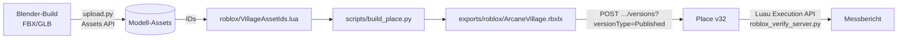

# Veröffentlichen und Open Cloud

Zurück: [[Arcane Village – Übersicht]] · Doku: `docs/ROBLOX_GAMEPLAY_IMPORT.md`, `docs/BLOCKERS_STUDIO.md`

> [!info] Warum Open Cloud?
> Roblox Studio war nie verfügbar. Über die Open-Cloud-Web-API lassen sich trotzdem Modelle
> hochladen, den Place veröffentlichen und **Luau-Skripte auf einem echten Roblox-Server
> ausführen** – dadurch ist vieles *im Place gemessen*, nicht nur lokal.

## Ablauf

1. Modelle hochladen → Asset-IDs in `roblox/VillageAssetIds.lua` eintragen.
2. `scripts/build_place.py` schreibt `exports/roblox/ArcaneVillage.rbxlx` (alle Skripte in
   ReplicatedStorage, ServerScriptService, ServerStorage, StarterPlayerScripts).
3. Veröffentlichen (siehe [[Befehle – Spickzettel]]). Antwort `HTTP 200 {"versionNumber": …}`.
4. `scripts/roblox_verify_server.py <universeId> <placeId>` führt beide Server-Startskripte im
   Place aus und misst Welt, Markt, Rohstoffe, Boden, Bänder, Werkstätten.

> [!warning] Fallstricke
> - Die `.rbxlx` muss **exakt mit `</roblox>` enden** – ein Zeilenumbruch danach ergibt
>   `400 Invalid Content stream`.
> - `versionType=Saved` speichert nur, veröffentlicht nicht.
> - Der API-Key gehört nicht ins Repository; in der Cloud setzt ihn der Proxy ein.

## Beim Serverstart (`VillageAutoBuild`)
- Lädt die Bibliotheken (`InsertService:LoadAsset`), baut das Dorf mit Meshes – ohne Meshes als
  Greybox (Voxel-Gelände + Block je Gebäude).
- Verfeinert im Hintergrund Boden und Kollision (~40 s) → [[Gelände, Kollision und Boden]].
- `Bootstrap.server.lua` legt Remotes, Werkstätten, Marker, Rohstoffe, Markt und Händler an.

## Letzte Messung (Version 32)
- 13 Bibliotheken geladen, 0 fehlgeschlagen, 287 MeshParts; 144/144 Vorlagen; 1 879 Objekte.
- `VillageReady=true errors=0`, `[Arcane] server ready - persistent saves: true`.
- 5 Händler: je 9 skinned + texturierte Meshes, 26 Knochen, Füße auf dem Boden, Handgelenke im
  Posen-Nachbau ≤ 0,0005 Studs neben Blender.
- 16 Ortsmarkierungen, 22 Sammelstellen mit Modell und Prompt, Hologramm = gebautes Teil.

## Versionsgeschichte (Auszug)

| Version | Inhalt |
|---|---|
| 8 | Erstes Dorf im Place, 180°-Importfehler gefunden |
| 9–10 | Markt, Werkstätten, Serverstart fehlerfrei |
| 13 | graue Geländestücke behoben |
| 14 | Rohstoffmodelle statt Kreise |
| 17 | Bedienung, Markierungen, Bodenhöhen |
| 18 | Gliederfiguren als Händler |
| 19 | Fix Nutzer-IDs (Kessel „gibt es nicht mehr“) |
| 20 | Wählbare Maschinenanschlüsse, Maschinenfenster |
| 21 | Item-Modelle und Bildbogen |
| 23–24 | Ware gleitet, Aufzug/Tor-Animation |
| 26–27 | Weißes Hologramm |
| 30–31 | Realistische Händler mit Skelett, Griff-Löser |
| **32** | Gelöste Armhaltungen, echte Hammertreffer, animierte Handgelenke |

Asset-IDs der aktuellen Händler (in `VillageAssetIds.lua`, `ArcaneMarketAssets`):
Selma 102593741391234 · Nyra 108048366764790 · Lio 86257344031359 · Aron 90222244544083 ·
Esme 129560284909085 · Stände 122869519424675.
