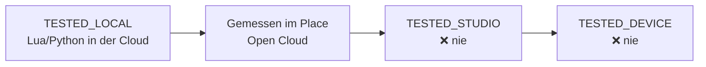

# Tests und Prüfungen

Zurück: [[Arcane Village – Übersicht]] · Ein Befehl: `./scripts/check_all.sh`

> [!summary] Letzter Lauf (2026-11-18)
> `ALL CHECKS PASSED (TESTED_LOCAL only - nothing here runs in Roblox Studio)`

## Was `check_all.sh` ausführt

| Schritt | Datei | Prüft |
|---|---|---|
| data integrity | `roblox/gameplay/tests/test_data.py` | Items, Rezepte, Maschinen, Querverweise |
| lua syntax | `test_syntax.py` | alle Luau-Module kompilieren (Lua-5.1-Teilumfang) |
| gameplay core / progression / adapters | `run_tests.py` | `spec_core`, `spec_progression`, `spec_adapter`, `spec_ports`, `spec_goods` |
| village builder (mock) | `tests/test_roblox_builder.py` | Welt-Builder gegen Roblox-API-Mock |
| place file + auto build | `tests/test_place_and_autobuild.py` | `.rbxlx` wohlgeformt, Greybox, Markt, Händler-Schleifen |
| asset registry | `tests/test_asset_registry.py` | jedes exportierte Asset hat seinen Builder |
| grip profiles + loop wrists | `tests/test_grip_profiles.py` | Profile, geschlossene Schleifen, Handgelenkgrenzen |
| world validation | `blender/validate.py` | 34 Weltprüfungen |

`--full` zusätzlich: Gameplay-, Rohstoff-, Item-Assets neu bauen + Rückseiten-Audit.

## Wie Luau ohne Roblox getestet wird
- Interpreter: **Lua 5.5 über `lupa`** (Python), dazu `tests/roblox_mock.lua` bzw.
  `roblox/gameplay/tests/harness.py`.
- Darum Luau nur im Lua-5.1-Teilumfang → [[Arbeitsregeln und Konventionen]].

## Schwerere Prüfungen (nicht in check_all)
- `blender/validate_grips.py` – Griffe mit Renderbögen → [[Griffvalidierung und Ergebnisse]]
- `blender/build_characters.py` – Build-Checks der Händler
- `blender/grip_test_crate.py` – Zwei-Hand-Test
- `scripts/roblox_verify_server.py` – Messung im echten Place → [[Veröffentlichen und Open Cloud]]
- `blender/audit_backfaces.py` – jedes Mesh aus 10 Richtungen auf Rückseiten

## Prüfstufen

> [!caution] Grenze
> Ein grüner Build beweist nicht, dass Bedienung, Aussehen oder Spielgefühl stimmen.
